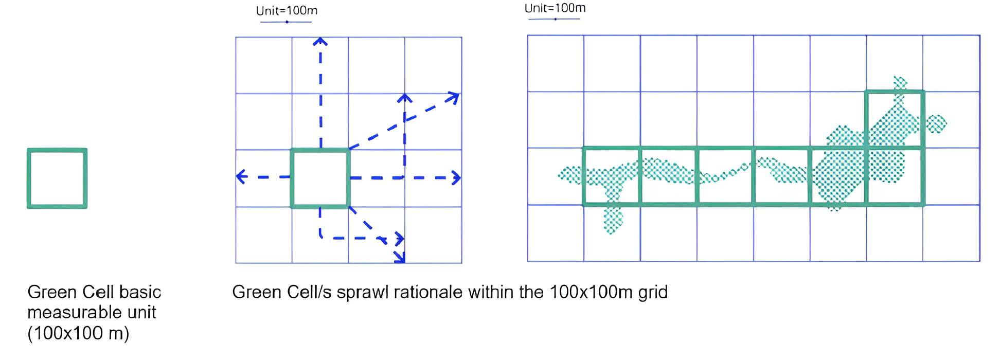

<div align="center">
  
</div>

# Assessing the Robustness of Optimization-Based Decision Support Systems

**Master Thesis in Artificial Intelligence @ University of Bologna**

Optimization-based decision support systems can make spatial trade-offs in urban planning explicit, but their recommendations may depend strongly on uncertain input data. This repository contains the code of a thesis that studies this issue on the **TALEA Bologna Green Cells** case study, where MiniZinc optimization models select candidate locations for modular green interventions over a 100×100 m city grid.

The work:

1. reconstructs the baseline data pipeline, preprocessing stages and MiniZinc models of the TALEA case study;
2. injects **controlled synthetic perturbations** into environmental, demographic, land-use, geometric and allocation-related inputs;
3. compares every perturbed solution with its no-noise baseline using **spatial** and **quantitative** robustness metrics;
4. aggregates the results in a **cross-model comparison** of average stability, lower-tail fragility and degradation trends across perturbation levels.

> This work builds on the TALEA Green Cells placement pipeline developed by [Christian Di Buò](https://www.linkedin.com/in/christiandibuo/) and [Simone Reale](https://www.linkedin.com/in/simreale). See [Credits](#credits).

## Background: TALEA Green Cells

Bologna, like many European cities, faces growing challenges from climate change, biodiversity loss, pollution and unequal access to public space. Urban Heat Islands (UHI) and Urban Heat Waves (UHW) particularly threaten vulnerable communities.

The **TALEA** project, supported by the *European Urban Initiative – Innovative Actions (EUI-IA)*, introduces **TALEA Green Cells (TGCs)**: modular, adaptable green units that reconnect fragmented green areas, regenerate underutilized spaces and create local climate refuges.

<div align="center">
  
</div>

TGC placement is modeled as a **Combinatorial Optimization Problem**. At the *macro scale* (statistical areas) it weighs *population density*, *existing green* and *UHEI*; at the *micro scale* (grid cells) four models are available:

| Model | `--model` | Objective |
|:--|:--|:--|
| Standard | `std` | Maximize a utility directly proportional to new green areas and inversely to existing ones. |
| Difference | `diff` | Same idea as Standard, but accounts for existing green in a differential way. |
| Inverse UHEI | `inverse_uhei` | Maximize the impact of the FVC on the inverse UHEI. |
| NDVI | `ndvi` | Maximize the impact of the FVC on the NDVI via a quadratic relation, inversely proportional to the cell's current NDVI. |

## Robustness Methodology

### Perturbations

Each perturbation is defined by a **noise type**, a **noise source** and a **severity level** (1–5).

| Noise type | Description | Applicable sources |
|:--|:--|:--|
| `gauss` | Additive Gaussian noise | `ndvi`, `uhei`, `population_density`, `green_area`, `ext_space`, `street_space`, `full_space`, `num_areas` |
| `multiplicative` | Multiplicative noise | `ndvi`, `uhei`, `population_density`, `green_area`, `ext_space`, `street_space`, `full_space` |
| `mislabelling` | Random label flips | `land_use`, `population_density` |
| `missingness` | Randomly removed records | `population_density`, `trees`, `num_areas` |
| `geometric` | Shrinking / warping of geometries | `green_area`, `ext_space`, `street_space` |
| `aggregation` | Alternative aggregation (`mean`, `median`) | `ndvi`, `uhei` |

### Metrics

Each perturbed solution is compared with the corresponding no-noise baseline.

| Metric | `--metric` | Kind | Meaning |
|:--|:--|:--|:--|
| Jaccard similarity | `jaccard` | Spatial | Overlap between the selected cell sets. |
| Centroid-buffer IoU | `iou_buffer` | Spatial | Overlap after matching selected cells within a distance buffer (default 300 m). |
| Utility ratio | `utility_diff` | Quantitative | Objective value of the perturbed solution over the baseline. |
| Yard allocation ratio | `yard_util` | Quantitative | Yard space allocated, perturbed over baseline. |
| Street allocation ratio | `street_util` | Quantitative | Street space allocated, perturbed over baseline. |

For the cross-model comparison, all metrics are normalized to a 0–100 robustness scale: `100 * score` for spatial metrics and `100 * min(r, 1/r)` for ratios, so that increases and decreases from the baseline are treated symmetrically.

### Key results (full map)

| Model | Mean robustness | Median | Worst case |
|:--|--:|--:|--:|
| `inverse_uhei` | 94.0 % | 98.1 % | 42.1 % |
| `std` | 93.9 % | 97.9 % | 44.5 % |
| `ndvi` | 92.0 % | 98.8 % | 0.6 % |
| `diff` | 84.1 % | 98.0 % | 21.2 % |

Most outputs are stable on average, but specific model–source–perturbation combinations are fragile: for example, Gaussian noise on NDVI strongly shifts the solutions of the `ndvi` model. The full report is in [`evaluation/full/comparison/comparison_report.md`](evaluation/full/comparison/comparison_report.md) and the plots are in [`plot/full/comparison/`](plot/full/comparison/).

> The analysis is scenario-based and reproducible, but it is not a full Monte Carlo uncertainty quantification.

## Usage

### 1. Get the data

The `dataset/` folder is **not included** in this repository because of its size (the perturbed datasets amount to ~49 GB). Download the raw data from the sources listed in [Data Sources](#data-sources) and place it in `dataset/raw_data/`:

```
dataset/raw_data/
├── alberi-manutenzioni.fgb
├── aree-boschive.gpkg
├── aree-fluviali.gpkg
├── aree-statistiche.geojson
├── aree-stradali.geojson
├── carta-tecnica-comunale-binari-ferroviari.fgb
├── ferrovia.geojson
├── localita_abitative.gpkg
├── popolazione_per_area_statistica.csv
├── rifter_edif_pl.geojson
├── un_gest.fgb
├── uso_suolo_bologna.geojson
├── verde_privato_urbanizzato.fgb
└── indexes/
    ├── ndvi_mean.geojson
    └── urban_heat_exposure_index.geojson
```

All perturbed datasets are then generated by the pipeline below.

### 2. Start the container

Docker is required. From the repository root:

```bash
cp .env.example .env
docker-compose up --build -d
docker exec -it talea_dev bash
```

### 3. Run the pipeline

All commands are available inside the container. Run any of them with `--help` for the full list of options.

| Command | Step |
|:--|:--|
| `data_processing` | Perturbs the raw input data (`ndvi`, `uhei`, `land_use`, `population_density`). |
| `grid_creation` | Builds the grid and the processed dataset, optionally applying noise. Needed on the first run and whenever the geometry or the noise changes. |
| `run_model` | Creates the MiniZinc instance and solves it with the chosen model and parameters. |
| `eval_metrics` | Computes robustness metrics against the baseline, produces plots and runs the cross-model comparison. |

Example: baseline vs. Gaussian noise on UHEI, level 2, with the `diff` model:

```bash
# Baseline
grid_creation --size full
run_model --size full --model diff

# Perturbed scenario
data_processing --noise_type gauss --noise_source uhei --noise_level 2
grid_creation --size full --noise_type gauss --noise_source uhei --noise_level 2
run_model --size full --model diff --noise_type gauss --noise_source uhei --noise_level 2

# Evaluation
eval_metrics --size full --model diff --metric all
eval_metrics --size full --model diff --metric all --plot True
eval_metrics --size full --metric all --compare True
```

Outputs:

- Solutions: `results/<size>/<model>/std/`
- Per-model metrics: `evaluation/<size>/<model>/<metric>.csv`
- Per-model plots: `plot/<size>/<model>/`
- Cross-model comparison: `evaluation/<size>/comparison/` and `plot/<size>/comparison/`

## Repository Structure

```
config/          Configuration files for the center and full map
src/
├── Minizinc/    MiniZinc models and generated instances
├── process_data.py    Input perturbations
├── grid_creation.py   Grid construction
├── preprocessing.py   Feature computation per cell
├── data_parser.py     MiniZinc instance generation
├── solver.py          Solver wrapper
├── evaluation.py      Robustness metrics and comparison
└── utils.py
results/         Optimization outputs (GeoJSON)
evaluation/      Robustness metrics (CSV) and comparison report
plot/            Robustness plots
frontend/        Web GUI to explore GeoJSON results
doc/             Sphinx documentation of the original pipeline
data_processing, grid_creation, run_model, eval_metrics   CLI entry points
```

## Data Sources

<details>
<summary>Open data used by the pipeline</summary>

**Land use**
- [Urban fabric](https://geoportale.regione.emilia-romagna.it/approfondimenti/database-uso-del-suolo) (Geoportale Emilia-Romagna): land use classified with a hierarchical legend derived from Corine Land Cover.

**Green cover**
- [Municipal Green](https://opendata.comune.bologna.it/explore/dataset/un_gest/information/) (Open Data Bologna): green units maintained by the Municipality.
- [Private Green](https://opendata.comune.bologna.it/explore/dataset/verde_privato_urbanizzato/information/) (Open Data Bologna): private green areas.
- [Municipal Trees](https://opendata.comune.bologna.it/explore/dataset/alberi-manutenzioni/information/) (Open Data Bologna): coordinates and type of each tree.
- [Forest areas](https://geoportale.regione.emilia-romagna.it/catalogo/dati-cartografici/ambiente/carte-forestali/provincia-di-bologna) and [Riverscape](https://geoportale.regione.emilia-romagna.it/catalogo/dati-cartografici/acque-interne) (Geoportale Emilia-Romagna).

**Human infrastructure**
- [CTC – Buildings](https://opendata.comune.bologna.it/explore/dataset/rifter_edif_pl/information/) (Open Data Bologna).
- [CTC – Road areas](https://opendata.comune.bologna.it/explore/dataset/aree-stradali/information/) (Open Data Bologna).

**Statistical data**
- [Statistical Areas](https://opendata.comune.bologna.it/explore/dataset/aree-statistiche/information/) (Open Data Bologna): 90 statistical areas.
- [Population per statistical area](https://inumeridibolognametropolitana.it/dati-statistici/popolazione-residente-quartiere-zona-e-area-statistica-al-31-dicembre).

**Environmental indices**
- [Urban Heat Island Analysis](https://github.com/TALEA-platform/uhi) (TALEA): NDVI, LST, albedo and the Urban Heat Exposure Index from Landsat 8/9 and MODIS.

</details>

## Credits

The baseline pipeline (data preprocessing, grid creation, MiniZinc models, GUI and documentation) was developed by **Christian Di Buò** and **Simone Reale** within the TALEA project. Their [documentation](https://talea-documentation.netlify.app/) and [GUI](https://talea-gui.netlify.app/) describe the original methodology in detail.

This thesis extends it with the perturbation framework, the robustness metrics and the cross-model comparison.

## License

Released under the [Apache License 2.0](LICENSE).
